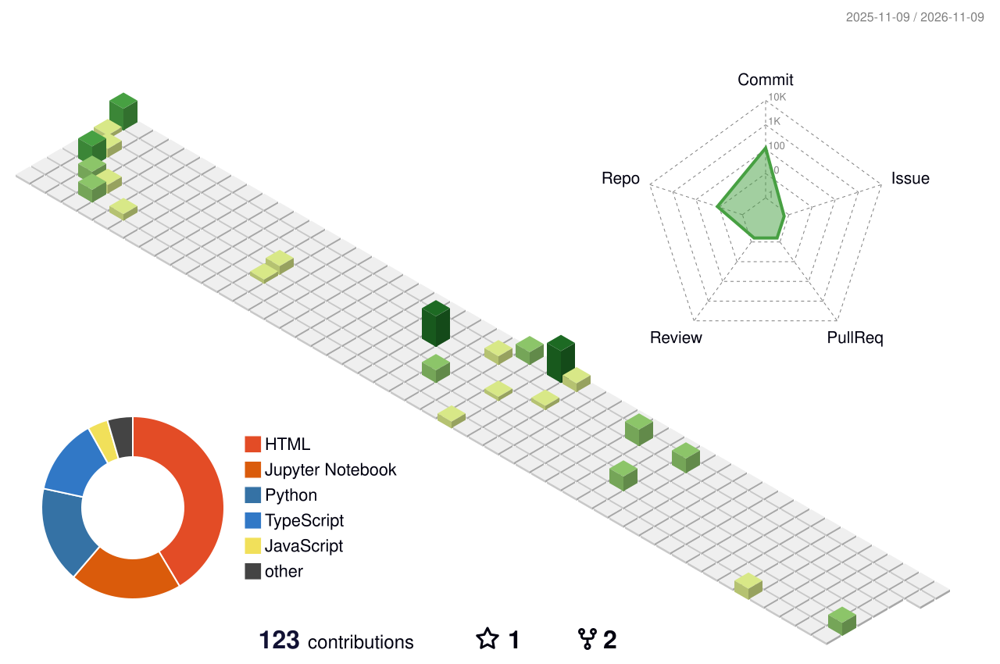

<div align="center">

<!-- ══════════════════ HEADER ══════════════════ -->


<!-- ══════════════════ BOOT SEQUENCE (adaptive) ══════════════════ -->
<a href="https://github.com/Likith-2004">
  <picture>
    <source media="(prefers-color-scheme: dark)" srcset="https://readme-typing-svg.demolab.com?font=JetBrains+Mono&weight=600&size=20&duration=3000&pause=800&color=22D3EE&center=true&vCenter=true&width=800&height=70&lines=%3E+model.load()+...+%E2%9C%93+READY;%3E+role%3A+AI+Engineer+%7C+Deep+Learning+%2B+Computer+Vision;%3E+shipping%3A+ML+pipelines+%E2%86%92+production;%3E+status%3A+final-year+AI%2FML+%40+MIT+Mysore">
    
  </picture>
</a>


</div>

<!-- ══════════════════ ABOUT ══════════════════ -->
##  System Profile


```python
class LikithVK(AIEngineer):

    def __init__(self):
        self.role      = "AI Engineering Intern @ DigiBull AI"
        self.education = "B.E. AI & ML, Maharaja Institute of Technology Mysore"
        self.evolution = [
            "Web Development",     # where it began
            "Computer Vision",     # taught machines to see
            "Deep Learning",       # taught them to diagnose
            "Production ML"        # now shipping it
        ]
        self.building  = ["ML price-estimation pipelines",
                          "Document intelligence",
                          "Explainable medical imaging"]
        self.learning  = ["Docker", "Kubernetes", "AWS", "Kafka"]

    def fun_fact(self):
        return "Give me a hard problem and a deadline ⚡"
```

<br clear="right"/>

<div align="center">

`🩺 Explainable medical AI` &nbsp;•&nbsp; `🏭 ML for electronics manufacturing` &nbsp;•&nbsp; `🐳 Docker → Kubernetes`

</div>

<br/>

<!-- ══════════════════ TECH STACK ══════════════════ -->
## 🛠️ Tech Arsenal

<div align="center">

<table>
  <tr>
    <td align="center" width="170">
      <br/>
      <strong>Deep Learning<br/>& Computer Vision</strong>
    </td>
    <td>
      <sub><strong>FRAMEWORKS</strong></sub><br/>
      
      
      
      <br/><br/>
      <sub><strong>CONCEPTS</strong></sub><br/>
      
      
      
      
      
    </td>
  </tr>
  <tr>
    <td align="center" width="170">
      <br/>
      <strong>Machine Learning<br/>& MLOps</strong>
    </td>
    <td>
      
      
      
      
      
      
    </td>
  </tr>
  <tr>
    <td align="center" width="170">
      <br/>
      <strong>Languages<br/>& Data Science</strong>
    </td>
    <td>
      
      
      
      
      
    </td>
  </tr>
  <tr>
    <td align="center" width="170">
      <br/>
      <strong>Web<br/>& APIs</strong>
    </td>
    <td>
      
      
      
      
    </td>
  </tr>
  <tr>
    <td align="center" width="170">
      <br/>
      <strong>Databases<br/>& Tools</strong>
    </td>
    <td>
      
      
      
      
    </td>
  </tr>
</table>

</div>

<br/>

<!-- ══════════════════ PROJECTS ══════════════════ -->
## 🚀 Featured Builds

<div align="center">

<table>
  <tr>
    <td width="33%" valign="top">
      <h3>🧠 Brain Tumor Detection</h3>
      <sub>ResNet18 classifier for 4 MRI tumor classes, with Grad-CAM heatmaps and test-time augmentation, served through a Flask app.</sub>
      <br/><br/>
      
      
      
      <br/><br/>
      <a href="https://github.com/Likith-2004/brain-tumor-detection"><b>→ View repo</b></a>
    </td>
    <td width="33%" valign="top">
      <h3>🫁 Pneumonia Detection</h3>
      <sub>CNN that flags pneumonia in chest X-rays, with augmentation, explainability overlays and an end-to-end diagnostic web flow.</sub>
      <br/><br/>
      
      
      
      <br/><br/>
      <a href="https://github.com/Likith-2004/chest-pneumonia-detection"><b>→ View repo</b></a>
    </td>
    <td width="33%" valign="top">
      <h3>🛢️ Oil Spill Detection</h3>
      <sub>Segments oil-spill regions in satellite imagery to automate large-scale environmental monitoring.</sub>
      <br/><br/>
      
      
      
      <br/><br/>
      <a href="https://github.com/Likith-2004/oil-spill-detection"><b>→ View repo</b></a>
    </td>
  </tr>
</table>

</div>

<br/>

<!-- ══════════════════ STATS (adaptive) ══════════════════ -->
##  Telemetry

<div align="center">

<picture>
  <source media="(prefers-color-scheme: dark)" srcset="https://github-readme-stats-theta-nine.vercel.app/api?username=Likith-2004&show_icons=true&theme=tokyonight&hide_border=true&bg_color=00000000&title_color=22D3EE&icon_color=38BDF8&count_private=true&include_all_commits=true">
  
</picture>
<picture>
  <source media="(prefers-color-scheme: dark)" srcset="https://streak-stats.demolab.com?user=Likith-2004&theme=tokyonight&hide_border=true&background=00000000&ring=38BDF8&fire=22D3EE&currStreakLabel=22D3EE">
  
</picture>

<picture>
  <source media="(prefers-color-scheme: dark)" srcset="https://github-readme-stats-theta-nine.vercel.app/api/top-langs/?username=Likith-2004&layout=compact&theme=tokyonight&hide_border=true&bg_color=00000000&title_color=22D3EE&langs_count=8">
  
</picture>
<picture>
  <source media="(prefers-color-scheme: dark)" srcset="https://github-profile-summary-cards.vercel.app/api/cards/productive-time?username=Likith-2004&theme=tokyonight&utcOffset=5.5">
  
</picture>

</div>

<br/>

<!-- ══════════════════ 3D CONTRIBUTION SKYLINE (self-hosted SVG — never breaks) ══════════════════ -->
<div align="center">

## 🏙️ Contribution Skyline

<picture>
  <source media="(prefers-color-scheme: dark)" srcset="https://raw.githubusercontent.com/Likith-2004/Likith-2004/main/profile-3d-contrib/profile-night-green.svg">
  
</picture>

</div>

<br/>

<!-- ══════════════════ SNAKE (adaptive) ══════════════════ -->
<div align="center">

## 🐍 The Model Training On My Contributions

<picture>
  <source media="(prefers-color-scheme: dark)" srcset="https://raw.githubusercontent.com/Likith-2004/Likith-2004/output/github-snake-dark.svg">
  
</picture>

</div>

<br/>

<!-- ══════════════════ CONNECT ══════════════════ -->
##  Establish Connection

<div align="center">

<a href="https://linkedin.com/in/likith-vk-929b5b28d"></a>
<a href="https://kaggle.com/vklikith"></a>
<!-- Add your portfolio link and uncomment:
<a href="https://YOUR-PORTFOLIO-URL"></a>
-->
<a href="mailto:likithvk2004@gmail.com"></a>

<br/><br/>


<br/><br/>

<!-- ══════════════════ FOOTER ══════════════════ -->
<picture>
  <source media="(prefers-color-scheme: dark)" srcset="https://readme-typing-svg.demolab.com?font=JetBrains+Mono&size=16&duration=4000&pause=1000&color=38BDF8&center=true&vCenter=true&width=600&lines=%22Models+are+easy.+Shipping+them+is+the+job.%22;%3E+model.save()+...+see+you+soon+%F0%9F%91%8B">
  
</picture>


</div>
